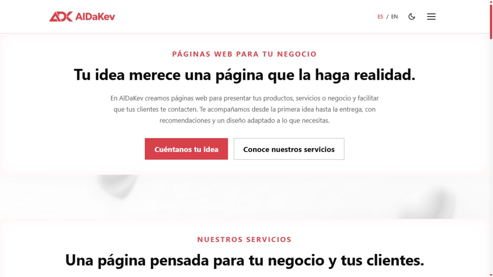

# AlDaKev

## Tu idea merece una página que la haga realidad.

Creamos páginas web para presentar tus productos, servicios o negocio y facilitar que tus clientes te contacten. Te acompañamos desde la primera idea hasta la entrega, con recomendaciones y un diseño adaptado a lo que necesitas.

**[Visita aldakev.com](https://aldakev.com)** · [Nuestros servicios](https://aldakev.com/#servicios) · [Cuéntanos tu idea](https://aldakev.com/#contacto)

*Vista real del sitio en modo claro. Pulsa la imagen para explorar la página.*

## Sobre nosotros

AlDaKev nace de tres amigos con un objetivo común: que cualquier persona o negocio pueda tener una página web clara, cuidada y hecha a su medida, sin necesidad de conocimientos técnicos.

Trabajamos de forma cercana y transparente. Antes de construir, escuchamos; durante el proyecto, proponemos mejoras y mantenemos una comunicación constante; y al entregar, nos aseguramos de que sepas cómo sacarle partido a tu página.

Nuestro compromiso es cumplir al cien por cien lo que acordemos contigo, cuidando cada detalle del diseño, el contenido y el funcionamiento. Cada proyecto comienza con una conversación: organizamos el contenido, acordamos el alcance y revisamos contigo las decisiones de diseño. Así sabes qué incluye tu página y qué esperar en cada etapa.

### Nuestra forma de trabajar

| Compromiso | Qué significa para tu proyecto |
| --- | --- |
| **Escuchar** | Entendemos tu idea antes de proponer. |
| **Proponer** | Te recomendamos lo que mejora tu página. |
| **Cumplir** | Entregamos lo acordado y seguimos contigo. |

## Qué hacemos

Diseñamos y desarrollamos páginas para presentar productos, mostrar servicios y dar a conocer negocios, marcas y proyectos profesionales. Escuchamos lo que buscas y te recomendamos una propuesta acorde con tus objetivos.

### Diseño para celulares y computadoras

Tu página se adapta a diferentes tamaños de pantalla para que tus clientes puedan navegar y encontrar la información fácilmente.

### Formularios de contacto

Facilitamos que las personas te envíen consultas o solicitudes directamente desde tu página.

### Contacto por redes y aplicaciones

Integramos accesos a las redes sociales y aplicaciones de contacto que utilices para comunicarte con tus clientes.

### Orientación durante el proyecto

Te ayudamos a definir la estructura, organizar el contenido y elegir las opciones que mejor se ajusten a tu idea.

### Seis meses de acompañamiento gratuito

Durante los primeros seis meses después de la entrega, incluimos mantenimiento, cambios y sugerencias sin costo adicional.

## De tu primera idea a tu página publicada

1. **Nos cuentas qué necesitas.** Queremos conocer tu negocio, lo que deseas mostrar y lo que esperas conseguir con tu página. Si todavía no tienes todo definido, te ayudamos a darle forma.
2. **Te recomendamos una propuesta.** Revisamos las opciones contigo y definimos las funciones, el contenido, los materiales necesarios, el precio y el plazo de entrega.
3. **Diseñamos y desarrollamos.** Construimos tu página según lo acordado, manteniendo la comunicación contigo para revisar avances y recibir tus comentarios.
4. **Revisamos y ajustamos contigo.** Comprobamos el diseño, el contenido y el funcionamiento. Escuchamos tus observaciones y realizamos los ajustes acordados para preparar la entrega.
5. **Publicamos y entregamos tu página.** Publicamos tu página y te explicamos lo necesario para empezar a utilizarla.
6. **Seguimos acompañándote.** Durante los primeros seis meses después de la entrega, incluimos mantenimiento, cambios y sugerencias sin costo adicional.

## Páginas creadas por nosotros

### [Expensal](https://expensal.com)

Una plataforma de finanzas personales para organizar ingresos, gastos, presupuestos y metas de ahorro.

**[Visitar Expensal](https://expensal.com)** · [Ver nuestro portafolio](https://aldakev.com/#proyectos)

## Explora nuestro sitio

En [aldakev.com](https://aldakev.com) encontrarás nuestros servicios, las etapas de trabajo, información sobre el equipo, proyectos y preguntas frecuentes. Puedes navegar en español o inglés y elegir entre modo claro y oscuro.

Consulta las [preguntas frecuentes](https://aldakev.com/#preguntas) para conocer más sobre precios, plazos, materiales, dominio, alojamiento y acompañamiento después de la entrega.

## Hablemos de tu proyecto

No necesitas tener todos los detalles resueltos para empezar. Comparte tu idea y te ayudaremos a explorar las opciones para tu página.

- **Sitio web:** [aldakev.com](https://aldakev.com)
- **Consultas:** [Formulario de contacto](https://aldakev.com/#contacto)
- **Correo:** [services@aldakev.com](mailto:services@aldakev.com)
- **Privacidad:** [Política de privacidad](https://aldakev.com/privacidad.html)

---

Este repositorio es la presentación pública de AlDaKev. La información sobre servicios y acompañamiento corresponde a lo publicado en nuestro sitio oficial.
